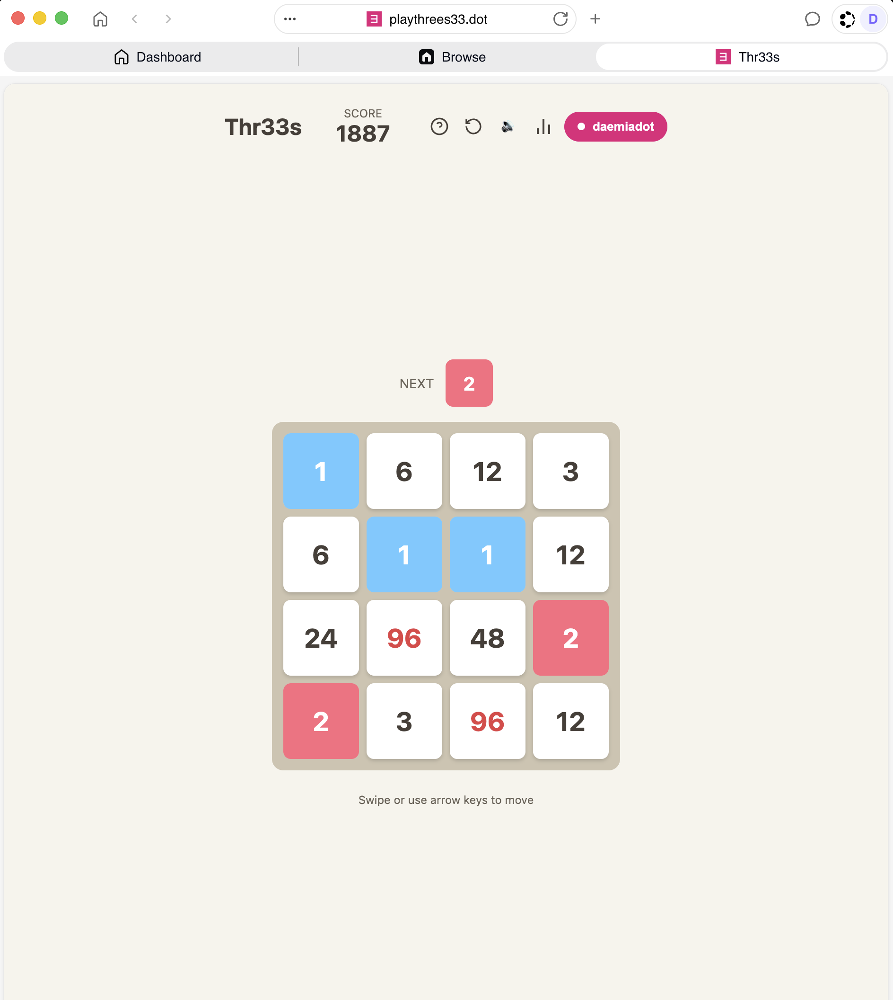

# Thr33s

A tile-sliding puzzle game with an **on-chain leaderboard**, built as a Polkadot
product. Slide the board, merge tiles, and sign your high score to the chain
with your Polkadot identity — no wallet extension, no tokens.

**▶ Play:** open **`playthr33s.dot`** in the Polkadot app, or on the web at
**[playthr33s.dev-dot.li](https://playthr33s.dev-dot.li)** (Products Devnet).



## How to play

- **Swipe** (touch) or use the **arrow keys** to slide every tile one step.
- **`1 + 2` make `3`.** From there, only equal tiles merge: `3 + 3 = 6`,
  `6 + 6 = 12`, `12 + 12 = 24`, …
- A new tile slides in after every move. The **Next** preview shows what's
  coming. Once you reach 48, bigger bonus tiles occasionally appear.
- The game ends when no move is possible. Every tile of 3 or more scores
  `3^(log2(tile/3) + 1)` — so a 3 is worth 3, a 6 is 9, a 12 is 27, a 24 is 81.
- Sign in with the Polkadot app to **submit your score**. The top 100 make
  the leaderboard, and your personal best is kept on-chain.

## How it works

| Piece | What it is |
|---|---|
| **Identity** | Thr33s is Proof-of-Personhood only. Inside a Polkadot host (Polkadot app, Desktop, or the dev-dot.li web host) you sign in with your Polkadot app; the game gets a **product account** derived for `playthr33s.dot`, and shows your PoP username (e.g. `daemia.01`). |
| **Fees (PGAS)** | Players need no PAS. On sign-in the app requests a `SmartContractAllowance`; the host mints **PGAS** (People Gas) to the product account and maps it for contracts. Score submissions are signed as **v5 general transactions** (`txExtVersion: 1`) — the only kind Asset Hub charges in PGAS. |
| **Leaderboard** | [`contracts/Thr33sLeaderboard.sol`](contracts/Thr33sLeaderboard.sol), a Solidity contract compiled to PolkaVM and running on `pallet-revive` on Paseo Asset Hub. Keeps the top 100 scores (score, highest tile, time) and each player's personal best. |
| **Hosting** | The built site is stored on the **Bulletin chain** and published under the DotNS name `playthr33s.dot`, with an on-chain product manifest (name, icon, `appVersion`) so hosts can launch and update it. |
| **Frontend** | TypeScript + Vite, no framework. Chain access via [`polkadot-api`](https://github.com/polkadot-api/polkadot-api) and [`@parity/product-sdk`](https://github.com/paritytech/product-sdk) (`-host`, `-contracts`, `-address`). |

### Networks

| Network | Name | Web | Notes |
|---|---|---|---|
| **Products Devnet** (current) | `playthr33s.dot` | [playthr33s.dev-dot.li](https://playthr33s.dev-dot.li) | Fees in PGAS — players need nothing. |
| Paseo Next v2 | `playthrees33.paseo` | [playthrees33.paseo.li](https://playthrees33.paseo.li) | Older deployment; no PGAS fee path, so players need PAS. |

The network is chosen at build time (`VITE_NETWORK`); see
[`src/web3/config.ts`](src/web3/config.ts).

## Develop

```bash
npm install
npm run dev      # local dev server
npm run build    # typecheck + production build → dist/
```

The game itself works anywhere. Sign-in and score submission need a Polkadot
host, so test those on the deployed app (Polkadot app, Desktop, or
dev-dot.li).

### Project layout

| Path | What |
|---|---|
| `src/game/` | Game logic: board, moves, tile deck, scoring, saved state |
| `src/ui/` | Rendering, animations, touch input, modals, hints |
| `src/audio/` | Sound effects (Web Audio) |
| `src/web3/` | Host sign-in (`host-wallet.ts`), contract client (`client.ts`), leaderboard (`leaderboard.ts`), per-network config (`config.ts`), v5 extension defaults (`pipeline1.ts`) |
| `contracts/` | `Thr33sLeaderboard.sol` |
| `scripts/deploy.mjs` | One-time contract deploy |
| `polkadot-app-deploy.config.ts` | Product manifest: display name, icon, `appVersion` |

## Deploy

Every push to `main` builds the site and publishes it to the Products Devnet
via GitHub Actions. Bump `appVersion` in `polkadot-app-deploy.config.ts` with
each release so hosts pick up the new build. Details — contract deployment,
the CI account, Bulletin storage authorization — are in
**[DEPLOY.md](DEPLOY.md)**.

## License

MIT
